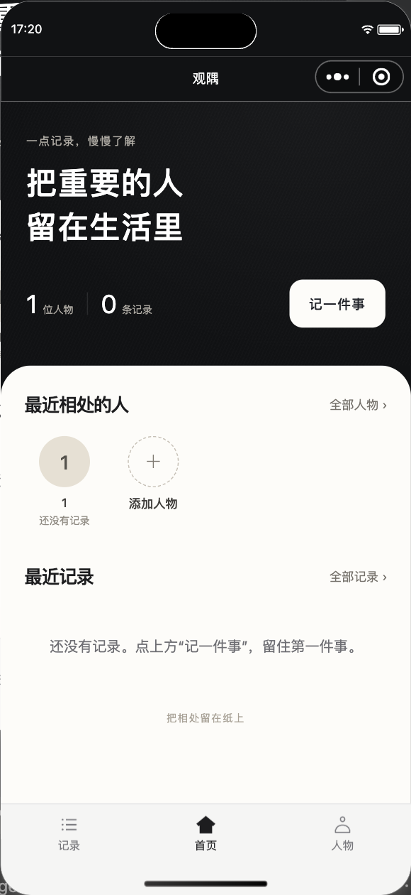
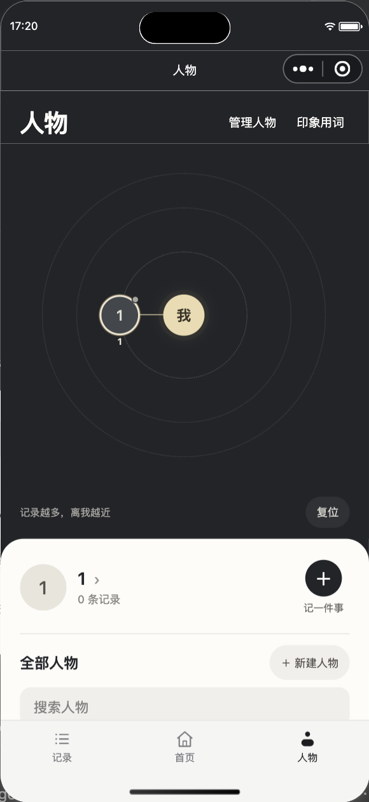
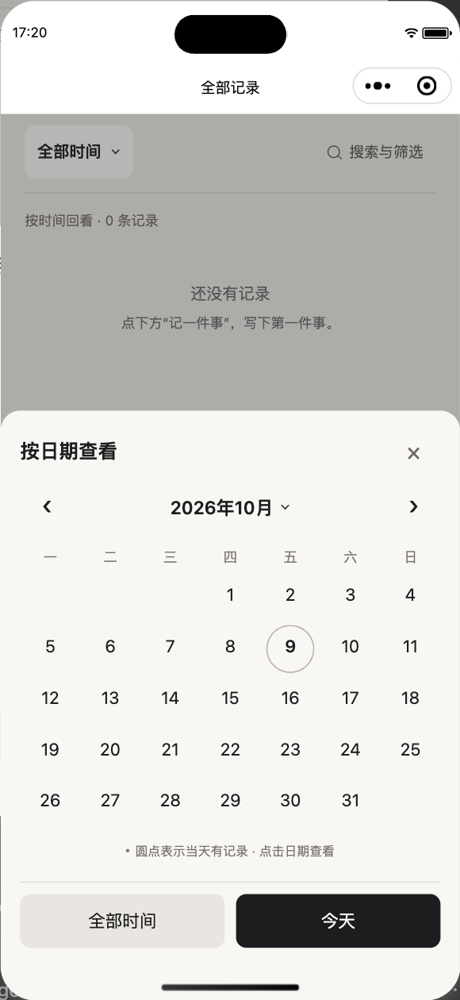
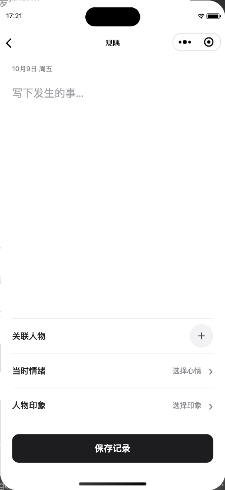

# 念隅里 · 微信小程序

记录与他人相处时发生的事、当时的心情和人物印象，方便日后回顾。

微信原生小程序 + 微信云开发，支持本地示例预览。

## 界面预览

| 首页 | 人物 |
| :---: | :---: |
|  |  |
| **日期筛选** | **快速记录** |
|  |  |

截图为早期版本，页面名称以「念隅里」为准。

## 功能

管理人物资料与头像；记录事件、心情和人物印象；按日期、人物和关键词查找记录。支持多人关联，以及心情、印象用词管理。

## 本地预览

1. 下载项目，将 `config/cloud.example.js` 复制为 `config/cloud.js`，保持 `envId` 为空。
2. 用微信开发者工具导入项目根目录，填写自己的小程序 AppID。
3. 点击编译，使用示例数据预览，修改保存在本机。

## 云开发

1. 开通云开发，将环境 ID 填入 `config/cloud.js` 的 `envId`。
2. 创建 `people`、`events`、`tags`、`user_settings` 集合，权限设为仅管理端可读写，由云函数访问。
3. 右键 `cloudfunctions/guanyuApi`，选择“上传并部署：云端安装依赖”。
4. 重新编译，新建人物并保存记录，确认读写正常。

云端数据按微信用户分别保存，头像上传到云存储。本地示例数据不会自动迁入云端；修改云函数后需重新部署。

## 目录

| 目录 | 内容 |
| --- | --- |
| `pages/` | 小程序页面 |
| `components/`、`custom-tab-bar/` | 公共组件与导航 |
| `assets/`、`styles/` | 图片与样式 |
| `utils/`、`config/` | 工具函数与配置示例 |
| `cloudfunctions/` | 云函数 |
| `tests/`、`docs/` | 测试、文档与截图 |

请使用自己的 AppID 和云环境，勿提交本地配置、密钥或真实用户数据。公开文件范围见 [发布说明](docs/PUBLISHING.md)。

## 测试

完成本地配置后，在 Node.js 环境运行：

```sh
node --test tests/*.test.cjs
```

## 许可证

采用 [MIT 许可证](LICENSE)，允许使用、修改和商用，需保留版权及许可声明。第三方依赖遵循各自许可证。
